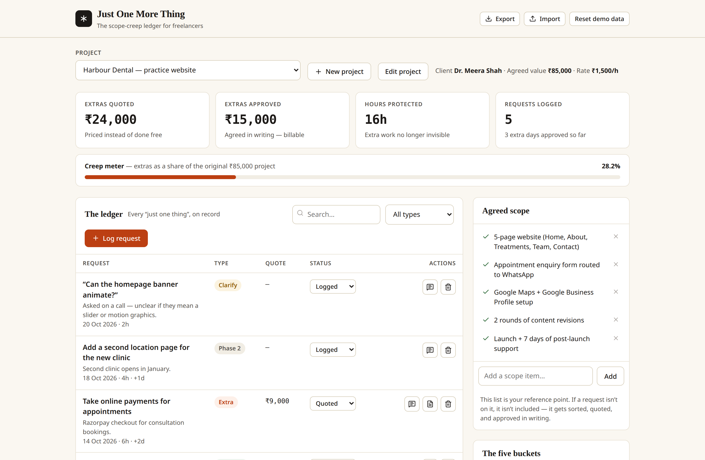
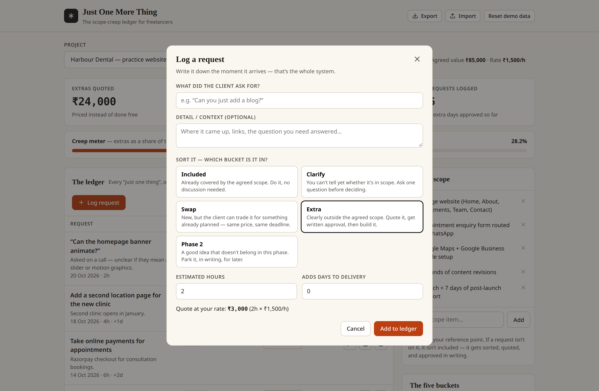
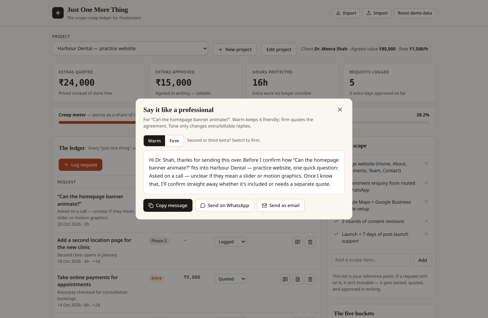

# Just One More Thing

**The scope-creep ledger for freelancers.**

**Live demo:** https://just-one-more-thing-eight.vercel.app/


Every freelancer knows the sentence: *"Can you just add one small thing?"*
One blog here, one animation there — and a five-week project quietly becomes
nine weeks of work for the original price. Community discussions on Reddit
and dev.to say the same thing over and over: the problem isn't difficult
clients, it's that **nothing was ever written down**.

Just One More Thing fixes that with one habit: **every request goes in the
ledger first.** Then it gets sorted, priced, and approved in writing —
before a single line of code is written.







## How it works

1. **Set up the project once** — client, agreed value, your hourly rate, and
   the exact scope you agreed to. That list is your reference point.
2. **Log every request the moment it arrives** — "just add online payments",
   "can the banner animate?", all of it.
3. **Sort it into one of five buckets** — the system experienced freelancers
   actually use:
   - **Included** — already in the agreed scope. Do it, no discussion.
   - **Clarify** — can't tell yet. Ask one question before deciding.
   - **Swap** — new, but trades against something already planned.
   - **Extra** — outside scope. Quote it, get written approval, then build.
   - **Phase 2** — a good idea that doesn't belong in this phase. Parked, in writing.
4. **Send the message** — the app writes the reply for you: warm for the first
   extra, firm when it's the third. Copy it, or send straight to WhatsApp/email.
5. **Issue the change order** — a clean, printable one-page document with the
   cost, timeline impact, and an approval line. Your paper trail.
6. **Watch the creep meter** — extras as a percentage of the original project
   value, plus totals for quoted money, approved money, and hours protected.

## Features

- Multi-project ledger with per-project scope, rate, and currency (₹ / $ / € / £)
- Automatic quotes for extras (hours × your rate) and timeline impact
- Client-ready messages in two tones, generated from the actual request
- Printable change-order documents (print / save as PDF)
- Status workflow: Logged → Quoted → Approved → Done / Declined, with approval dates
- Search and filtering across the ledger
- **Local-first and private** — everything is stored in your browser
  (localStorage). No account, no server, no client data leaving your machine.
- JSON export/import for backups

## Tech stack

| Layer | Tech |
|---|---|
| App | React 19 + TypeScript (strict) |
| Build | Vite 8 |
| Icons | Lucide |
| Tests | Vitest (pricing, stats, and message generation) |
| CI | GitHub Actions — type-check, tests, production build |

The design is a deliberate paper-ledger system — warm paper, ink, one ember
accent, serif display type. No gradients, no glassmorphism, no AI-template
look. The full system is documented in [DESIGN.md](DESIGN.md).

## Run it locally

```bash
npm install
npm run dev        # http://localhost:5173
npm test           # unit tests
npm run build      # production build
```

The app ships with realistic demo data (a dental practice website) so you can
see the whole flow immediately. Use **Reset demo data** in the header any
time, or replace it with your own projects.

## Why I built this

I'm a freelance developer (BrandForge Media). Scope creep nearly ate the
margin on my early client projects — not because clients were unreasonable,
but because "small things" were agreed on calls and never written down.
This is the tool I now use on my own projects, open-sourced in case it
saves another freelancer the same lesson.

## Roadmap

- [ ] Optional cloud sync (bring-your-own backend)
- [ ] Recurring clients view across projects
- [ ] Change-order PDF with your own letterhead/logo
- [ ] Browser extension to log requests from Gmail/WhatsApp Web

Issues and ideas are welcome — see [CONTRIBUTING.md](CONTRIBUTING.md).

## License

MIT — see [LICENSE](LICENSE). Use it, fork it, ship client work with it.
